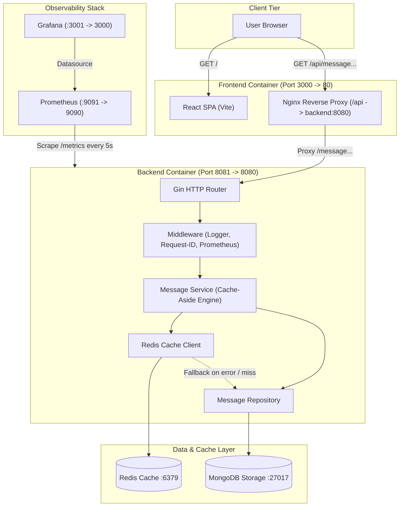

# Hello World Cloud-Native Application

A production-grade, cloud-native demonstration application showcasing modern full-stack development, **Cache-Aside** performance patterns, **observability (Prometheus & Grafana)**, multi-stage **Docker containerization**, and **CI/CD automation**.

---

## Architecture Overview



---

## Technology Stack

| Layer | Technology | Details |
|---|---|---|
| **Frontend** | React 18, Vite, Axios | Clean UI with interactive cache toggles, latency counters, and error states. |
| **Reverse Proxy** | Nginx (Alpine) | Serves the React bundle and reverse-proxies `/api/*` to the backend. |
| **Backend API** | Go (1.23+), Gin Framework | Clean architecture, robust parameter validation, graceful shutdown. |
| **Cache Layer** | Redis 7 (Alpine) | Cache-aside pattern under key `hello-world:message:1` with 300s TTL. |
| **Database** | MongoDB 7.0 | Persistent message storage (`hello_world.messages`), seeded with `{ _id: "1" }`. |
| **Monitoring** | Prometheus | Scrapes backend `/metrics` every 5 seconds. |
| **Visualization** | Grafana 11 | Pre-provisioned dashboards for Application, Cache, and Database metrics. |
| **CI/CD** | GitHub Actions | Independent CI pipelines for Frontend and Backend testing and packaging. |

---

## Key Features & Design Patterns

1. **Cache-Aside Pattern:**
   * Reads check Redis first. On a **cache hit**, the message is returned immediately with `"source": "cache"`.
   * On a **cache miss** or when `cache=0`, the backend queries MongoDB, returns `"source": "mongodb"`, and asynchronously warms Redis.
   * **Fault Tolerance:** If Redis is down, the API logs a warning, increments `cache_errors_total`, and seamlessly falls back to MongoDB without failing the user request.
2. **Structured Logging:**
   * Every request emits a single JSON log to stdout containing `timestamp`, `level`, `request_id`, `endpoint`, `duration_ms`, `status`, and `source`.
3. **Distributed Request Tracing:**
   * Incoming `X-Request-ID` headers are propagated or generated via UUID and attached to response headers.
4. **Automated Provisioning:**
   * Dashboards and datasources in Grafana load automatically on container startup without manual setup.

---

## Quick Start (Local Docker Compose)

### Prerequisites
* [Docker Desktop](https://www.docker.com/products/docker-desktop/) (running on WSL2 or Linux/macOS)
* [Git](https://git-scm.com/)

### 1. Configure Environment
```bash
cp .env.example .env
```

### 2. Launch the Application Stack
```bash
docker compose up --build -d
```

### 3. Verify Container Health
```bash
docker compose ps
```
All services should display status `healthy` or `Up`.

---

## Access Points & URLs

| Service | URL | Credentials / Notes |
|---|---|---|
| **React Web App** | [http://localhost:3000](http://localhost:3000) | Main UI (includes cache toggle & refresh) |
| **Backend API** | [http://localhost:8081](http://localhost:8081) | Direct API endpoint |
| **Grafana Dashboards** | [http://localhost:3001](http://localhost:3001) | User: `admin` / Password: `admin` |
| **Prometheus UI** | [http://localhost:9091](http://localhost:9091) | Scrape targets and metric explorer |
| **MongoDB Compass** | `mongodb://localhost:27017` | Database: `hello_world`, Collection: `messages` |

---

## API Reference

### 1. `GET /message`
Retrieve the application message with cache-aside behavior.

**Query Parameters:**
| Parameter | Type | Required | Default | Description |
|---|---|---|---|---|
| `fromdb` | int | Yes | `1` | Must be `1` in current implementation |
| `cache` | int | No | `1` | `1` = Enable Redis cache-aside; `0` = Bypass cache |
| `sql` | int | No | `0` | `0` = MongoDB; `1` = Reserved (returns `501 Not Implemented`) |

**Sample Response (Cache Hit):**
```json
{
  "message": "Hello World",
  "source": "cache"
}
```

**Sample Response (Database Read):**
```json
{
  "message": "Hello World",
  "source": "mongodb"
}
```

---

### 2. `GET /health`
Liveness and container health check probe.
```json
{
  "status": "UP"
}
```

---

### 3. `GET /metrics`
Prometheus metrics endpoint exposing:
* `http_requests_total{method,status,endpoint}`
* `http_request_duration_seconds{method,endpoint}`
* `cache_hits_total`
* `cache_misses_total`
* `cache_errors_total`
* `db_reads_total{database}`
* `db_errors_total{database}`

---

## Local Development & Unit Tests

### Backend (Go)
```bash
cd backend
go test -v -race ./...
go run ./cmd/server
```

### Frontend (React)
```bash
cd frontend
npm install
npm run dev      # Local Vite dev server on http://localhost:3000
npm run build    # Production bundle
```

---

## CI/CD Pipelines

This repository includes two independent **GitHub Actions** workflows:

1. **Backend CI (`.github/workflows/backend-ci.yml`):**
   * Triggered on changes to `backend/**`.
   * Verifies module dependencies, runs `go vet`, executes unit tests with race detection, and builds the backend Docker image.
2. **Frontend CI (`.github/workflows/frontend-ci.yml`):**
   * Triggered on changes to `frontend/**`.
   * Installs Node.js dependencies (`npm ci`), builds the production Vite bundle, and packages the Nginx frontend Docker image.

---

## Project Structure

```text
.
├── .github/
│   └── workflows/
│       ├── backend-ci.yml           # Backend CI pipeline
│       └── frontend-ci.yml          # Frontend CI pipeline
├── backend/
│   ├── cmd/server/main.go           # Application entrypoint & graceful shutdown
│   ├── internal/
│   │   ├── cache/                   # Redis cache client & interfaces
│   │   ├── config/                  # Environment variable configuration
│   │   ├── handler/                 # HTTP Gin handlers & route tests
│   │   ├── metrics/                 # Prometheus collectors definition
│   │   ├── middleware/              # Logger, Request-ID, Metrics middlewares
│   │   ├── repository/              # MongoDB repository & seed logic
│   │   └── service/                 # Cache-aside business logic & tests
│   ├── Dockerfile                   # Multi-stage Go Alpine Docker build
│   └── go.mod
├── frontend/
│   ├── src/
│   │   ├── App.jsx                  # Main UI component
│   │   └── App.css                  # UI styling
│   ├── Dockerfile                   # Multi-stage Node + Nginx Docker build
│   ├── nginx.conf                   # Nginx reverse proxy & security headers
│   └── vite.config.js
├── monitoring/
│   ├── prometheus/prometheus.yml    # Prometheus scrape config
│   └── grafana/
│       ├── dashboards/              # Application, Cache, & DB dashboards
│       └── provisioning/            # Automated datasources & dashboard providers
├── docs/
│   ├── DESIGN.md                    # System architecture & design document
│   ├── REQUIREMENT.md               # Functional & non-functional requirements
│   └── DEVELOPMENT_TESTING_DEPLOYMENT_PLAN.md
├── scripts/
│   └── init-mongo.js                # MongoDB idempotent initialization script
├── docker-compose.yml               # Local multi-service orchestration
└── README.md
```

Like ?